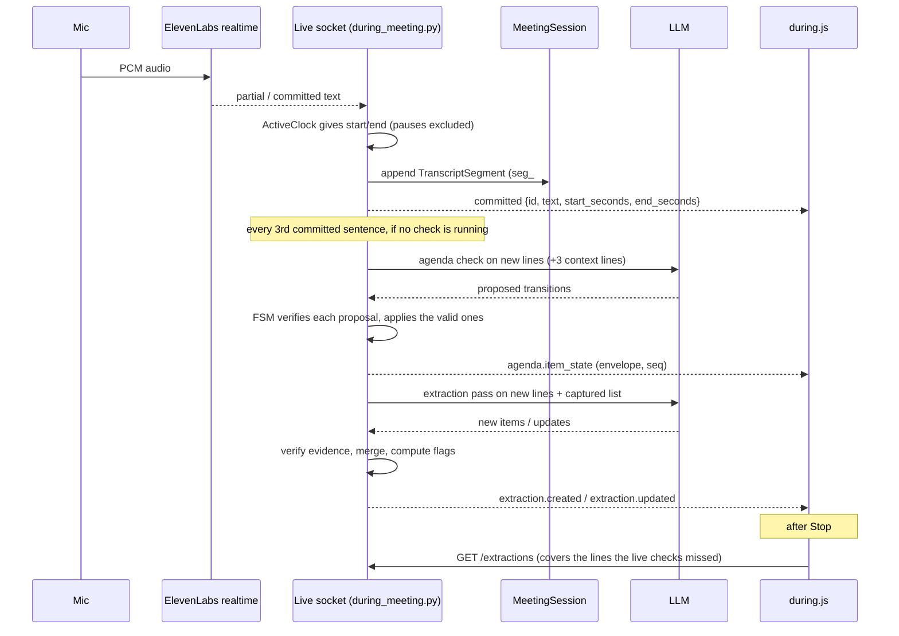

# Live meeting analysis: agenda state machine and extractions

> **Status:** implemented on branch `feat/extractions-agenda-fsm` (2026-11-21). Contract version 0.2.0.
> **Scope:** two features that run *while people talk*:
> 1. **Agenda FSM.** Each agenda item moves `not_discussed → in_progress → discussed → concluded` (and `discussed → in_progress` when reopened), driven by the conversation.
> 2. **Extractions.** Decisions, action items, deadlines and unresolved issues are pulled out of the transcript, each with evidence (segment, quote, time).
>
> Both rest on a third piece: **transcript segments with ids and times** (`seg_001`, `start_seconds`, `end_seconds`).

Test material:
- English: `tests/e2e/live_demo_en/` (sample agenda, notes file, test script).
- Vietnamese: `tests/e2e/fsm_demo/`.

---

## 1. What is done, and where it shows

| Piece | Backend | Front end (`during.html` / `during.js`) |
|---|---|---|
| Segment id and time | `speech_to_text/segments.py`, `realtime_transcriber.py` | The time column shows `m:ss` instead of "—" |
| `GET /meetings/{id}/transcript?after=` | `api/during_meeting.py` | Not called yet (the WebSocket already delivers the segments) |
| Agenda FSM | `agenda_tracker/fsm.py`, `agenda_tracker/tracker.py` | The state badge (text label), the colour on the clock track, the evidence quote as a tooltip |
| `agenda.item_state` event | Live socket in `api/during_meeting.py` | `onMessage` updates the agenda list |
| Live extractions | `extraction/extractor.py` | Tags under each cited transcript line, plus the **Captured so far** panel |
| `extraction.created` / `.updated` events | Live socket | Upsert by `id`, then re-render |
| `GET /meetings/{id}/extractions` | `api/extractions.py` | Called after a page refresh and after Stop (covers the last lines) |

**Not done** (separate tasks):
- The **Needs your choice** panel. Conflicts between two values need the Conflict / Task-merge task.
- `timer.sync`.
- Q&A.
- Showing extractions on the After page.
- Moving the events to the main socket `/ws/meetings/{id}`. They ride on `/ws/meetings/{id}/transcript-test` today.

---

## 2. How it works, end to end



Step by step:

1. **Sentence in.** ElevenLabs commits a sentence after a short silence (VAD). `realtime_transcriber.py` stamps it:
   - `start_seconds` is when the first partial for it arrived;
   - `end_seconds` is the commit time;
   - both come from an `ActiveClock` that stops while the meeting is paused.
2. **Segment stored.** The socket handler turns the event into a contract `TranscriptSegment`, appends it to `session["transcript"]`, and forwards it to the browser.
3. **Every 3 sentences** (`TRACK_EVERY`), one background task `analyse()` runs two checks one after the other, so a meeting makes at most one LLM call at a time:
   1. **Agenda check:**
      - The LLM gets the agenda (id, current state, title) and the lines not checked yet, with 3 earlier lines as context.
      - It proposes transitions.
      - `fsm.apply_proposals` keeps only the legal ones that have strong evidence and cite at least one new line.
      - Each one that passes changes the item and becomes an `agenda.item_state` event.
   2. **Extraction pass:**
      - The LLM gets the new lines (plus context) and the list of items already captured.
      - It returns new items, or updates of captured ones (`update_of`).
      - `merge_items` verifies the evidence, drops repeats, applies the updates, computes `missing_fields`, `is_low_confidence` and `needs_confirmation`, and emits the events.
4. **Failures are contained.**
   - An LLM error is logged, and the transcript keeps going.
   - The cursor of the failed check is not moved, so the next check covers those lines too.
5. **After Stop.**
   - The page calls `GET /extractions`. The backend runs one more pass on the lines after the extraction cursor, then stores the result.
   - Later GETs only read the stored list.
   - A batch transcript (`POST /transcribe`) starts with cursor 0, so the same call extracts everything.

---

## 3. Computational thinking analysis

### 3.1 Abstraction: what is kept, what is hidden

| Abstraction | Keeps | Hides / leaves out |
|---|---|---|
| **`TranscriptSegment`** (`make_segment`) | id, start/end seconds, text, language, confidence, low-confidence flag | Which STT path produced it. Batch speaker turns (`"MM:SS.cc - MM:SS.cc"`) and realtime commits end up in the same shape. Unknown values stay `null` and are never filled in. |
| **`Evidence`** = `{segment_ids, quote}` | *Where* a claim comes from, checkable by a machine | How the LLM reasoned. Only the verbatim words matter. |
| **`Extraction`**: one shape for 4 types | type, content, owner, deadline, evidence, flags | Type-specific details. The UI renders all four with one component. |
| **Agenda FSM** = 4 states + 4 allowed edges | The progress of a topic | Everything else in the talk (tone, side remarks, who spoke) |
| **`ActiveClock`** | "Meeting time": `now − start − paused time` | Wall clock and pause bookkeeping |
| **LLM as a proposer** | *Meaning* (is this a decision? did they move on?) | Authority. The LLM never writes state; the backend decides. |
| **Envelope** `{type, meeting_id, seq, at, data}` | Ordering and event type | Transport details. One parser in the UI handles every event. |

The key abstraction is the split between **propose** and **verify**. Language understanding is fuzzy, so the LLM does it. Rules are exact, so code enforces them: legal transitions, verbatim evidence, missing fields, flags. This is what meets the project rules "never guess missing fields" and "the backend is the source of truth".

### 3.2 Decomposition: modules and their single job

| Module | Responsibility | Pure? |
|---|---|---|
| `speech_to_text/segments.py` | Build segments, parse batch times, confidence from log-probabilities, `ActiveClock` | Yes |
| `speech_to_text/realtime_transcriber.py` | Microphone → STT → `committed` events carrying id and time | No (I/O) |
| `utils/evidence.py` | `verify` (quote verbatim in the cited segments), `locate` (the one segment holding a quote), `is_low_confidence` | Yes |
| `agenda_tracker/fsm.py` | `ALLOWED` edges, `apply_transition`, `apply_proposals` | Yes |
| `agenda_tracker/tracker.py` | Prompt and schema; `propose_transitions` (one LLM call) | LLM only |
| `extraction/extractor.py` | `build_extractions` (validate one batch), `merge_items` (create/update/dedupe), `extract_pass` (prompt + LLM + merge) | Pure except `extract_pass` |
| `api/during_meeting.py` | Scheduling (`TRACK_EVERY`, one task in flight), cursors, session writes, sending events | Orchestration |
| `api/extractions.py` | `GET` by meeting status: live read, or a tail pass after Stop | Orchestration |
| `utils/utils.py` → `envelope` | The WebSocket message wrapper | Yes |
| `frontend/js/during.js` | Render segments, tags, the Captured panel and agenda badges; no inference | UI |

The pure parts can be unit-tested with no network: `fsm`, `evidence`, `build_extractions`, `merge_items`, `segments`. The I/O parts are tested with fakes (`tests/unit/test_agenda_socket.py` replaces the STT stream and the LLM).

### 3.3 Pattern recognition: the same shapes, reused

1. **Propose → verify → apply → emit.** Both features follow it:

   | Step | Agenda | Extractions |
   |---|---|---|
   | Propose | `propose_transitions` | `extract_pass` (the LLM part) |
   | Verify | `ALLOWED` + `evidence.verify` + not low confidence + cites a new line | `evidence.verify` / `locate` + date and field cleaning |
   | Apply | Mutate the item's state and times | `merge_items` creates or updates |
   | Emit | `agenda.item_state` | `extraction.created` / `.updated` |

2. **Incremental cursor + context overlap.** Both checks keep a cursor: how many segments they have covered.
   - Each call sends `segments[cursor − 3 :]` and tells the LLM that lines before `segments[cursor]` are context only.
   - The cursor moves only after a success.
   - This one pattern gives no lost lines, no double counting, and bounded prompt size.
3. **Snapshot under the lock → LLM outside → write under the lock.** This is the same pattern as `generate_agenda` and `generate_minutes`, so a slow LLM never blocks other requests on the session.
4. **"Unknown stays null."** Used for segment times, confidence, speaker, assignee, deadline, and an unverifiable quote. A value is never repaired or guessed. It is flagged instead (`missing_fields`, "no evidence", `—`).
5. **Prefixed sequential ids.** `seg_###`, `ext_###`, like the existing `agd_###`. Ids are never reused, so the UI can upsert by `id`.

### 3.4 Algorithm design

**a) Evidence verification:** `evidence.verify`, O(total text length)

```
norm(s) = casefold( collapse_whitespace( NFC(s) ) )
verify(ids, quote) =
    quote non-empty  AND  ids non-empty  AND  every id exists
    AND norm(quote) is a substring of norm(join(text of ids, " "))
locate(quote) = [the id]  if exactly one segment contains norm(quote), else []
```

- NFC makes Vietnamese diacritics compare equal whatever the input encoding (precomposed or decomposed).
- `locate` repairs a common LLM mistake (a wrong segment id) only when the answer is unique, so it never guesses between two candidates.

**b) Agenda transition:** `fsm.apply_transition`, O(1) per proposal

```
apply(item, to, ids, quote, new_ids):
    if (item.state, to) ∉ ALLOWED                     → reject
    if new_ids given and ids ∩ new_ids = ∅             → reject   (old line, already used)
    if not verify(ids, quote) or any cited low-conf    → reject   (weak evidence)
    from = item.state;  item.state = to
    if to = in_progress: started_at ← started_at or now;  ended_at ← null   (reopen)
    else:                ended_at ← now
    return {agenda_item_id, from, to, evidence}
```

- The contract has no `in_progress → concluded` edge, so a decision stated mid-discussion is sent as two events (`→ discussed`, `→ concluded`) with the same evidence.
- The prompt also enforces "one topic at a time": opening a new item moves the old one to `discussed`.

**c) Incremental extraction merge:** `merge_items`, O(k · n) for k raw items and n stored items

```
for raw in llm_items:
    item = validate(raw)                                  # type, content, dates, evidence, flags
    target = store[raw.update_of]  (if that id exists)
    if no target:
        if same type AND (evidence ⊆ an existing item's evidence
                          OR no evidence and same content) → skip (repeat)
        item.id = next ext_###;  store.append(item);  emit created
    else:
        if item has no verified evidence → skip            # weak signal never edits
        changed = fields where item.value ≠ null and ≠ target.value
        if none → skip
        overwrote = any changed field already had a value  # e.g. deadline moved
        copy changed fields; evidence.segment_ids ← old ∪ new; quote ← new
        recompute flags; needs_confirmation ← flags OR overwrote OR was_flagged
        emit updated
```

- **`null` never erases.** In an update, `null` means "not said this time".
- **Flags only go up.** `needs_confirmation` is never cleared automatically, because only the user's confirmation may do that.
- **Both statements stay visible.** When a deadline moves, the union of `segment_ids` keeps the old and the new line, so a reviewer sees both.

**d) Scheduling:** in the socket handler

```
on committed sentence:
    count += 1
    if count mod TRACK_EVERY = 0 and no analyse() task running:
        start analyse():  track_agenda(); then extract_live()
```

- **Cost.** At most ⌈sentences / 3⌉ × 2 LLM calls, never in parallel.
- **No lines lost.** A skipped turn loses nothing, because the cursors cover the gap next time.
- **Tuning.** `TRACK_EVERY` trades delay against cost and the provider's rate limit.

**e) Meeting time:** `ActiveClock`

`seconds = now − started − paused_total − (now − paused_since if paused)`. It is tested with an injected fake clock.

---

## 4. How to reuse the code

| You want to… | Reuse | How |
|---|---|---|
| Add another live analyser (e.g. `summary.window`, live Q&A sources) | `analyse()`, cursor pattern, `envelope`, `send()` | Write `my_pass(segments, cursor, store, …) -> (store, events)` like `extract_pass`, keep its own cursor in the session, and call it inside `analyse()` after the two checks |
| Check any LLM claim against the transcript | `utils/evidence.verify`, `locate`, `is_low_confidence` | Pass the cited ids, the quote, and `{id: segment}` |
| Plug in another speech-to-text provider | `make_segment`, `ActiveClock`, `from_batch` | Emit `committed` events with `id`, `start_seconds`, `end_seconds`; or map provider output to `make_segment` |
| Let the user correct an agenda state by hand (future endpoint) | `fsm.apply_transition` | Pass the user's chosen line as evidence; the same rules apply |
| Build Task merge / Conflicts | `merge_items` update branch | The "overwrote a stated value" branch is the exact place a `conflict.created` should be raised instead of only flagging |
| Show extractions on the After page | `GET /extractions`, `extractionDetails`, `segmentTag` in `during.js` | Move the two helpers to a shared module when a second page needs them |
| Send a new WebSocket event | `utils.envelope` + `send()` in the socket handler | One shared `seq` counter keeps the order the contract asks for |

Constants to tune (all marked as design assumptions in code):

| Constant | Where | Value |
|---|---|---|
| `TRACK_EVERY` | `api/during_meeting.py` | 3 |
| `CONTEXT_LINES` | `tracker.py`, `extractor.py` | 3 |
| `LOW_CONFIDENCE_THRESHOLD` | `segments.py` | 0.6 |

---

## 5. Tests

| File | Covers |
|---|---|
| `tests/unit/test_segments.py` | Time parsing, batch conversion, the confidence flag, `ActiveClock` with pauses |
| `tests/unit/test_agenda_fsm.py` | Every allowed and refused transition, weak evidence, reopen, the two-step conclude, old lines cannot re-trigger |
| `tests/unit/test_extractions.py` | Validation, `missing_fields`, invented quotes, Vietnamese NFC/NFD, merge create/update/dedupe, the endpoint by status, the tail pass |
| `tests/unit/test_agenda_socket.py` | The live socket with fake STT and LLM: envelope and `seq` order, segments kept, LLM failure does not stop the transcript, cursors |
| `tests/test_realtime_controls.py` | Pause/resume/stop, plus committed events carrying an id and times |
| `tests/e2e/live_demo_en/test_script_en.md` | Manual end-to-end test with a microphone (English) |

Run them with:

```bash
.venv/bin/python -m unittest discover -s tests/unit -t .
```

A replay of the English script through the real LLM (text, no microphone) matched every expected agenda change. The replay is how the issues in §6 were found.

---

## 6. Limits and known risks

| Limit | Effect | Way forward |
|---|---|---|
| Segment times come from the backend clock at commit time | `end_seconds` lags the real end of speech by the VAD silence delay | Use the provider's word timestamps if realtime STT exposes them |
| Realtime STT gives no confidence | `is_low_confidence` is never true on the live path (it can be on batch, when the provider sends `logprob`) | Same as above |
| The backend checks that a quote **exists**, not that it **supports** the claim | A real sentence can still be misread by the LLM (e.g. an opinion taken as a decision) | Stronger prompts, few-shot examples, user confirmation (already required for official minutes) |
| 2 LLM calls per 3 sentences | Groq can answer HTTP 429 in fast talk | Raise `TRACK_EVERY`, or merge both checks into one call |
| `started_at` / `ended_at` use the time the backend accepted the change | They lag the speech by the LLM delay | Use the cited segment's `start_seconds` |
| Events ride on `/transcript-test`, and the older messages there have no `seq` | Not yet the main socket in the contract | Move them when the main socket is built |
| A moved deadline is flagged, not offered as a choice | The "Needs your choice" panel is still empty | Conflict task (`conflict.created`) |

Problems found by the real-LLM replays and fixed:
1. Two items were `in_progress` at once. Fixed with the prompt rule "one topic at a time".
2. Items never reached `concluded`. Fixed with the two-step conclude.
3. "Let's come back to it later" reopened an item several turns later. Fixed: a proposal must cite a new line.
4. Small talk was captured as an issue. Fixed with the prompt rule "ignore small talk".
5. `content` copied the whole sentence. Fixed: the prompt asks for a short summary.
