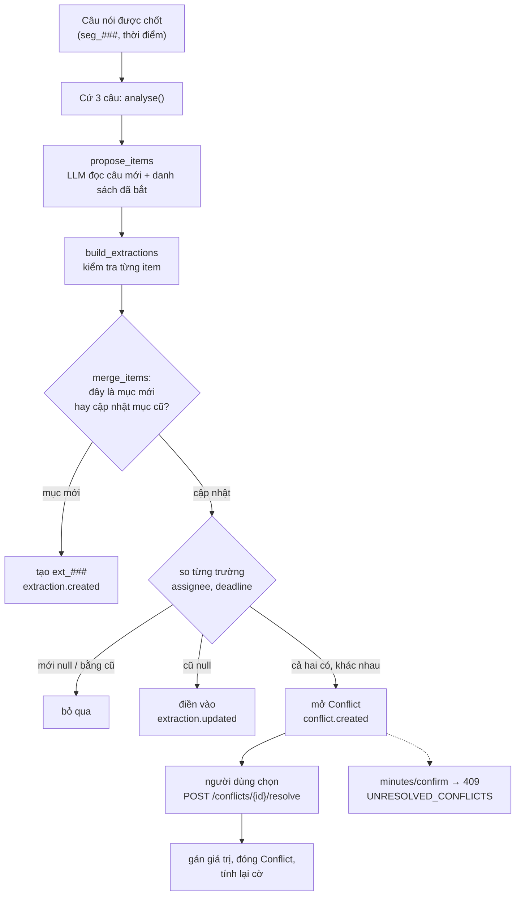

# Từ lời nói đến item, trường thiếu và xung đột

> Tài liệu này giải thích **cách tính năng hoạt động** và **các đoạn code quan trọng**.
> Nó bổ sung cho [README.md](README.md) (tổng quan, phân tích Computational Thinking).
> Phạm vi: từ lúc một câu được chốt cho tới lúc người dùng chọn giá trị đúng cho một xung đột.
> Code chính: [`extraction/extractor.py`](../../src/backend/extraction/extractor.py), [`utils/evidence.py`](../../src/backend/utils/evidence.py), [`api/extractions.py`](../../src/backend/api/extractions.py), [`api/conflicts.py`](../../src/backend/api/conflicts.py), [`api/during_meeting.py`](../../src/backend/api/during_meeting.py).

---

## 1. Tính năng làm gì

Khi mọi người nói, hệ thống tự ghi lại **quyết định, việc cần làm, hạn chót, vấn đề chưa giải quyết** (gọi chung là *extraction*) và đưa ra ba loại cảnh báo cho người chủ trì:

| Tình huống | Hệ thống làm gì |
|---|---|
| Việc chưa có **người phụ trách** hoặc chưa có **deadline** | Giữ `null`, ghi vào `missing_fields`, hiện thẻ trong khung **Needs your choice** với chữ "Not stated". Không đoán. |
| Về sau có người **nói ra** giá trị còn thiếu | Điền vào. Thẻ tự rời khung vì cờ được tính lại từ dữ liệu. |
| Cùng một việc nhưng được nói **hai giá trị khác nhau** (hai deadline, hai người) | Mở một **Conflict** có các phương án, mỗi phương án kèm câu trích. Người dùng chọn; hệ thống không chọn hộ. |

Ba quy tắc xuyên suốt, lấy từ CLAUDE.md của dự án:
1. **Backend là nguồn sự thật.** Giao diện chỉ hiển thị, không tự gộp hay tự so sánh.
2. **Không bao giờ đoán trường thiếu.** `null` luôn là `null`.
3. **Mọi item phải có bằng chứng** (câu trích nguyên văn, id câu, thời điểm). Không có thì ghi rõ "No evidence", không giấu.

---

## 2. Bức tranh tổng thể



Hai ý chính của thiết kế:

- **LLM đề xuất, code kiểm tra.** LLM giỏi hiểu nghĩa ("dời sang" nghĩa là đổi hạn) nhưng hay sai chi tiết. Mọi thứ cần chính xác (câu trích có thật không, ngày có hợp lệ không, hai giá trị có khác nhau không, trường nào đang thiếu) đều do code quyết định.
- **Xung đột là kết quả của phép so sánh**, không phải thứ LLM tuyên bố. LLM chỉ cần nói "đây là cập nhật của mục `ext_001`, deadline mới là 11/12". Chính `merge_items` mới thấy deadline cũ 28/11 khác 11/12 và mở xung đột.

---

## 3. Các cấu trúc dữ liệu

Khai báo ở [`utils/objects.py`](../../src/backend/utils/objects.py). Trong session, chúng nằm ở `session["transcript"]`, `session["extractions"]`, `session["conflicts"]`.

### 3.1 `TranscriptSegment`: một câu đã chốt

```json
{ "id": "seg_003", "start_seconds": 16.4, "end_seconds": 20.1,
  "text": "À, kế hoạch quảng cáo chị Yang thì dời sang ngày 11/12 nha.",
  "language": "vi", "confidence": null, "is_low_confidence": false }
```

`start_seconds` và `end_seconds` loại trừ thời gian tạm dừng (do `ActiveClock` tính). `confidence` là `null` khi nhà cung cấp không gửi; `null` **không** bị coi là độ tin cậy thấp.

### 3.2 `Extraction`: một item đã bắt được

```json
{
  "id": "ext_001", "type": "action_item",
  "content": "Chuẩn bị kế hoạch quảng cáo",
  "assignee": "Yang", "deadline": "2026-11-28",
  "evidence": { "segment_ids": ["seg_002"], "quote": "chuẩn bị kế hoạch quảng cáo trước ngày 28/11" },
  "missing_fields": [], "is_low_confidence": false,
  "needs_confirmation": false, "task_id": null
}
```

- `type` là một trong `decision`, `action_item`, `deadline`, `unresolved_issue`.
- `evidence.segment_ids` rỗng và `quote` rỗng nghĩa là **không có bằng chứng đã kiểm tra**.
- `task_id` luôn `null` vì kho Task chưa có; xung đột gắn vào `extraction_id` thay thế.

### 3.3 `Conflict`: hai (hoặc nhiều) giá trị cho một trường

```json
{
  "id": "cfl_001", "extraction_id": "ext_001", "task_id": null,
  "field": "deadline",
  "options": [
    { "value": "2026-11-28", "evidence": { "segment_ids": ["seg_002"], "quote": "..." } },
    { "value": "2026-12-11", "evidence": { "segment_ids": ["seg_003"], "quote": "dời sang ngày 11/12" } }
  ],
  "resolved": false, "chosen_value": null
}
```

`field` chỉ nhận `assignee` hoặc `deadline`. Mỗi phương án có **bằng chứng riêng**, nên người chọn thấy được ai nói gì, lúc nào.

---

## 4. Từng bước, kèm code

### 4.1 Lập lịch: khi nào gọi LLM (`api/during_meeting.py`)

```python
TRACK_EVERY = 3          # cứ 3 câu mới chốt, kiểm tra một lần

async def analyse():
    # Lần lượt, để một cuộc họp chỉ có tối đa một lời gọi LLM tại một lúc.
    await track_agenda()
    await extract_live()
```

- Không gọi LLM cho từng câu: một câu đơn lẻ thiếu ngữ cảnh ("Vậy chốt nhé.") và mỗi lần gọi tốn thời gian, tiền và giới hạn tốc độ của nhà cung cấp.
- Nếu lượt trước chưa xong khi đủ 3 câu tiếp theo, lượt này **bị bỏ qua** và không mất gì, vì có **con trỏ** (`extraction_cursor`) nhớ đã xử lý tới câu nào. Lượt sau xử lý luôn các câu bị lỡ.
- Con trỏ chỉ tiến lên **sau khi gộp kết quả thành công**. LLM lỗi thì con trỏ đứng yên và các câu đó được thử lại ở lượt sau; lỗi được ghi log và không làm dừng transcript.

### 4.2 Hỏi LLM: `propose_items`

Hàm chỉ làm **đúng một việc**: gọi LLM và trả về danh sách item thô. Nó không đụng vào session.

```python
window = segments[max(0, cursor - CONTEXT_LINES) :]   # câu mới + 3 câu ngữ cảnh
parts = [_INSTRUCTIONS.format(...), <agenda>, <captured>, <transcript>]
```

Prompt có bốn khối:

| Khối | Nội dung | Vì sao |
|---|---|---|
| Luật | Chỉ dùng điều có trong transcript; bỏ qua chuyện phiếm; `content` ngắn (khoảng 12 từ) theo ngôn ngữ cuộc họp; `null` khi không rõ; câu trích nguyên văn | Giảm bịa và giữ thẻ gọn |
| `<captured>` | Danh sách item **đã bắt** (id, loại, nội dung, người, hạn) | Để LLM biết cái gì đã có, và có thể trỏ `update_of` tới đúng id |
| `<agenda>` | Id và tiêu đề các mục agenda | Để gắn `agenda_item_id` |
| `<transcript>` | Câu mới và 3 câu trước, dạng `[seg_004] ...` | Câu trước chỉ làm ngữ cảnh; prompt ghi rõ chỉ báo điều nằm ở câu mới |

Lịch 14 ngày (`date_context`) cũng được chèn vào để LLM **chép ngày từ lịch** thay vì tự tính "thứ Sáu tuần sau", việc mà nó thường tính sai.

Schema ép LLM trả về `items`, mỗi phần tử có:

```
type, content, assignee|null, deadline|null, agenda_item_id|null,
update_of|null,           ← id của item cũ, nếu đây là cập nhật
segment_ids[], quote
```

`update_of` là trường quan trọng nhất cho xung đột. Prompt dặn: "một ngày mới hoặc ngày bị dời của một action item đã có luôn là cập nhật, không bao giờ là một mục `deadline` riêng hay bản sao của việc". Các từ khoá "dời sang", "lùi lại", "đổi hạn", "moved to", "now due" được nêu rõ.

### 4.3 Kiểm tra từng item: `build_extractions`

Đây là chốt chặn đầu tiên. Với mỗi item thô:

**(a) Bằng chứng.** Dùng [`utils/evidence.py`](../../src/backend/utils/evidence.py):

```python
def _norm(text):  # NFC + gộp khoảng trắng + casefold
    return " ".join(unicodedata.normalize("NFC", text).split()).casefold()

def verify(segment_ids, quote, by_id):   # mọi id phải tồn tại, quote phải nằm nguyên văn trong các câu đó
def locate(quote, segments):             # id của DUY NHẤT một câu chứa quote; không có hoặc mơ hồ thì []
```

- Chuẩn hoá NFC để dấu tiếng Việt so sánh được dù bàn phím hay LLM sinh dấu theo kiểu dựng sẵn hay tổ hợp. Hai chữ "Bình" khác mã hoá vẫn khớp.
- Nếu LLM trích đúng chữ nhưng ghi **sai số câu**, `locate` tìm lại, nhưng chỉ khi đúng một câu khớp. Có hai câu khớp thì bỏ cuộc, không đoán.
- Không kiểm tra được thì bằng chứng thành `{"segment_ids": [], "quote": ""}`. **Không tự điền.**

**(b) Làm sạch giá trị.**

```python
def _clean_date(value):
    try: return date.fromisoformat(text).isoformat()
    except ValueError: return None     # ngày sai định dạng thì coi như chưa biết, không sửa
```

Người phụ trách rỗng hoặc toàn khoảng trắng cũng thành `None`. `agenda_item_id` không có trong agenda thì thành `None`.

**(c) Tính cờ.** `_set_flags` được viết như một hàm **tính lại từ đầu**, không phải "bật lên mãi":

```python
REQUIRED_FIELDS = {"action_item": ("assignee", "deadline"), "deadline": ("deadline",)}

item["missing_fields"]    = [f for f in REQUIRED_FIELDS.get(item["type"], ()) if item[f] is None]
item["is_low_confidence"] = ev.is_low_confidence(item["evidence"]["segment_ids"], by_id)
item["needs_confirmation"] = bool(
    item["missing_fields"] or not item["evidence"]["segment_ids"]
    or item["is_low_confidence"] or _has_open_conflict(item["id"], conflicts)
)
```

Quyết định và vấn đề chưa giải quyết không có trường bắt buộc, vì chúng vốn không có người hay hạn. Nhờ tính lại từ dữ liệu, khi trường thiếu được điền hoặc xung đột được chọn thì `needs_confirmation` tự tắt và thẻ tự rời khung **Needs your choice**.

### 4.4 Gộp vào danh sách: `merge_items`

Đây là trái tim của tính năng. Hàm **không sửa đầu vào** (sao chép trước), trả về `(store, conflicts, events)`.

Với mỗi item đã qua kiểm tra, có **ba nhánh**:

```python
target = by_ext.get(raw.get("update_of")) or _same_task(item, store)

if target is None:
    if _same_as_captured(item, store): continue     # LLM nhắc lại điều đã có → bỏ
    ... tạo mới → "extraction.created"
else:
    if not item["evidence"]["segment_ids"]: continue # cập nhật không có bằng chứng → bỏ
    ... so từng trường  → điền / xung đột
```

**Nhánh 1, nhận ra "cùng một việc".** `target` được xác định bằng hai đường:

- **Đường A:** LLM chỉ ra qua `update_of`.
- **Đường B, lưới an toàn `_same_task`:** khi LLM quên `update_of`, backend tự đối chiếu:

```python
def _same_task(item, store):
    if item["type"] not in ("action_item", "deadline"): return None
    content = ev._norm(item["content"])
    for old in store:
        if old["type"] != "action_item" or ev._norm(old["content"]) != content: continue
        a, b = item["assignee"], old["assignee"]
        if a is None or b is None or ev._norm(a) == ev._norm(b):
            return old
    return None
```

Điều kiện: **tên việc giống hệt** (sau chuẩn hoá), và người phụ trách **trùng nhau hoặc một bên chưa rõ**. Cùng tên việc nhưng **hai người khác nhau** thì vẫn tách thành hai việc riêng, vì có thể hai người cùng làm một loại việc.

**Nhánh 2, mục mới.** Gán id `ext_###` tiếp theo và phát `extraction.created`. Trước đó `_same_as_captured` loại các bản lặp: cùng loại và tập câu dẫn là tập con của một mục cũ, hoặc không có bằng chứng và trùng nội dung.

**Nhánh 3, cập nhật mục cũ.** Chỉ chạy khi cập nhật có bằng chứng đã kiểm tra. Rồi duyệt `CONFLICT_FIELDS = ("assignee", "deadline")`:

```python
for field in CONFLICT_FIELDS:
    value = item[field]
    if value is None or value == target[field]:
        continue                                   # không nói gì mới → bỏ qua
    if target[field] is None:
        target[field] = value; filled = True       # đang thiếu → điền
    else:
        conflict = _record_conflict(conflicts, target, field, value, item["evidence"], meeting_id)
        if conflict is not None:
            events.append(("conflict.created", dict(conflict)))   # đã có giá trị, nay khác → xung đột
```

Bảng quyết định cho **một trường**:

| Giá trị mới | Giá trị đang có | Kết quả |
|---|---|---|
| `null` (câu này không nói) | bất kỳ | Bỏ qua. `null` không bao giờ xoá giá trị đang có. |
| bằng giá trị đang có | giống nhau | Bỏ qua. |
| có giá trị | `null` | **Điền vào**, cộng thêm câu dẫn mới. |
| có giá trị | có giá trị, **khác nhau** | **Mở xung đột** (hoặc thêm phương án vào xung đột đang mở). |

Cuối cùng cờ được tính lại bằng `_set_flags(target, by_seg, conflicts)` và nếu mục thay đổi thì phát `extraction.updated`.

### 4.5 Mở hoặc mở rộng xung đột: `_record_conflict`

```python
for conflict in conflicts:
    if conflict["extraction_id"] == target["id"] and conflict["field"] == field and not conflict["resolved"]:
        if value in (o["value"] for o in conflict["options"]): return None        # đã biết giá trị này
        conflict["options"].append({"value": value, "evidence": dict(evidence)})  # giá trị thứ ba, thứ tư...
        return conflict
# chưa có xung đột mở → tạo mới với hai phương án
"options": [ {"value": target[field], "evidence": <câu dẫn của cả mục>},
             {"value": value,         "evidence": <câu dẫn của lời vừa nói>} ]
```

Ba điểm cần nhớ:
- **Mỗi (việc, trường) chỉ có một xung đột đang mở.** Giá trị thứ ba cộng dồn vào chính nó và được gửi lại cùng `id`; giao diện cập nhật theo `id` nên không bị trùng thẻ.
- **Nhắc lại giá trị đã có thì không làm gì.**
- **Mục giữ nguyên giá trị nói đầu tiên** cho tới khi người dùng chọn. Không có chuyện "giá trị mới nhất thắng" vì điều đó là quyết định của con người.
- Hạn chế đã biết: phương án "giá trị cũ" lấy **toàn bộ** bằng chứng của mục chứ chưa tách theo từng trường, nên thời điểm hiển thị có thể là câu tạo ra mục chứ không phải đúng câu nói giá trị đó (ghi bằng comment `shortcut:` trong code).

### 4.6 Người dùng chọn: `resolve_conflict` và `api/conflicts.py`

```python
option = next((o for o in conflict["options"] if o["value"] == chosen_value), None)
if option is None: raise ValueError(chosen_value)     # chỉ được chọn một giá trị ĐÃ ĐƯỢC NÓI

conflict["resolved"] = True;  conflict["chosen_value"] = chosen_value
item[conflict["field"]] = chosen_value
item["evidence"] = _with_evidence(item["evidence"], option["evidence"])
_set_flags(item, ..., conflicts)                       # xung đột đã đóng → cờ tắt
```

- **Không cho nhập giá trị thứ ba tự do:** mỗi phương án đều có bằng chứng, giá trị tự nhập thì không có.
- Endpoint trả về lỗi theo `code`: `404 CONFLICT_NOT_FOUND`, `409 CONFLICT_ALREADY_RESOLVED`, `422 INVALID_CHOICE`, `409 INVALID_MEETING_STATE` (chỉ chọn được khi cuộc họp đang `live`, `paused`, `processing` hoặc `review`).
- Sau khi chọn, nếu về sau lại có giá trị mới khác, một xung đột **mới** (`cfl_002`...) được mở.

### 4.7 Chặn xác nhận biên bản: `api/post_meeting.py`

```python
open_conflicts = [c["id"] for c in session.get("conflicts", []) if not c["resolved"]]
if open_conflicts:
    return error(409, "UNRESOLVED_CONFLICTS", ...)
```

Đây là chốt chặn cuối: dù giao diện có lỗi, backend vẫn từ chối `POST /minutes/confirm`. Thẻ chỉ thiếu trường thì **không** chặn xác nhận; nó chỉ là lời nhắc.

---

## 5. Đồng bộ và an toàn khi chạy song song

Lời gọi LLM mất vài giây, trong lúc đó người dùng có thể bấm chọn một xung đột. Hai quy tắc tránh mất dữ liệu:

1. **Ảnh chụp, gọi LLM ngoài khoá, gộp trong khoá** (`extract_live` và `merge_into_session`):
   - đọc dữ liệu dưới `with session:` rồi nhả khoá;
   - gọi `propose_items` (chậm) **không giữ khoá**;
   - gộp kết quả vào **dữ liệu hiện tại** của session, không phải bản ảnh chụp cũ. Nhờ vậy lựa chọn người dùng vừa làm trong lúc chờ không bị ghi đè.
2. **Con trỏ chống gộp trùng:**
   ```python
   if session.get("extraction_cursor", 0) >= covered:
       return []        # một lượt khác đã xử lý các câu này rồi
   ```

Khi bấm Stop, trang gọi `GET /extractions`. Backend chạy thêm một lượt cho những câu sau con trỏ rồi lưu lại, nên 1 đến 2 câu cuối không bị bỏ sót.

---

## 6. Phía giao diện (chỉ hiển thị)

| Việc | File | Cách làm |
|---|---|---|
| Nhận sự kiện | [`during.js`](../../src/frontend/js/during.js) | `extraction.created` / `.updated` cập nhật `Map` theo `id`; `conflict.created` cập nhật `Map` xung đột theo `id`; hiện thông báo nhỏ và làm thẻ sáng lên một lần |
| Khung "Needs your choice" | [`review.js`](../../src/frontend/js/review.js) `renderReviewList` | Xung đột đứng trước, rồi các thẻ có `needs_confirmation`. Mục đã có thẻ xung đột thì không hiện lại thẻ thường |
| Nút chọn | `conflictCard` | Mỗi giá trị là một nút kèm thời điểm và câu trích; **không chọn sẵn** |
| Chọn xong | `chooseValue` | Gọi `resolve`, rồi tải lại extractions và conflicts từ backend (không tự sửa cục bộ) |
| Trang After | [`after.js`](../../src/frontend/js/after.js) | Cùng thành phần; nút Confirm bị khoá khi còn xung đột, và 409 sẽ tải lại danh sách |

Giao diện **không bao giờ** tự quyết định xung đột hay tự gộp item. Nó vẽ lại đúng những gì backend trả về.

---

## 7. Ví dụ chạy từng bước

Họp ngày Chủ Nhật 22/11, tiếng Việt.

```
seg_001  "Được rồi, mình bắt đầu với buổi họp hôm nay nha."
seg_002  "Thì chị Yang sẽ chuẩn bị kế hoạch quảng cáo trước ngày 28/11."
seg_003  "À, kế hoạch quảng cáo chị Yang thì dời sang ngày 11/12 nha."
```

**Lượt 1** (sau seg_002). LLM trả một item mới. `build_extractions` xác minh câu trích, ngày hợp lệ, cả hai trường đã đủ:

| id | content | assignee | deadline | missing_fields | needs_confirmation |
|---|---|---|---|---|---|
| ext_001 | Chuẩn bị kế hoạch quảng cáo | Yang | 2026-11-28 | `[]` | `false` |

Sự kiện: `extraction.created`.

**Lượt 2** (sau seg_003). `<captured>` đã có `ext_001`. LLM trả:

```
{ content: "Chuẩn bị kế hoạch quảng cáo", assignee: "Yang", deadline: "2026-12-11",
  update_of: "ext_001", quote: "dời sang ngày 11/12", segment_ids: ["seg_003"] }
```

`merge_items`:
1. `target = ext_001` (qua `update_of`; nếu LLM quên thì `_same_task` cũng tìm ra vì tên việc giống hệt và người trùng).
2. Câu trích nguyên văn nằm ở seg_003, nên bằng chứng hợp lệ.
3. `assignee`: "Yang" bằng "Yang", bỏ qua.
4. `deadline`: 11/12 khác 28/11, cả hai đều có → `_record_conflict` mở `cfl_001` với hai phương án.
5. `_set_flags`: có xung đột đang mở → `needs_confirmation = true`.

Sự kiện: `conflict.created` rồi `extraction.updated`. `ext_001.deadline` vẫn là **28/11**.

**Người dùng bấm "11/12".** `resolve_conflict` gán `ext_001.deadline = 2026-12-11`, đóng `cfl_001`, gộp thêm câu dẫn seg_003 vào bằng chứng, tính lại cờ. Thẻ rời khung **Needs your choice**.

**Biến thể: người nói "Tom làm đi" sau khi đã có "Yang".** Cùng cơ chế nhưng trên trường `assignee`: Yang khác Tom → mở `cfl_002`, `field: assignee`.

---

## 8. Các trường hợp biên

| Tình huống | Hành vi |
|---|---|
| Câu trích của cập nhật không có trong transcript | Cập nhật bị bỏ, không có xung đột giả |
| Cập nhật chỉ nói người, không nói ngày (`deadline: null`) | Chỉ xét trường người; ngày cũ giữ nguyên |
| Cùng tên việc nhưng **hai người khác nhau** | Tách thành hai item riêng |
| Cùng tên việc, một bên chưa rõ người | Coi là cùng việc; người được điền vào chỗ trống |
| LLM nhắc lại việc cũ kèm một deadline mà mục cũ đang thiếu | Deadline được điền vào, không tạo mục mới |
| Giá trị thứ ba khi xung đột còn mở | Thêm vào phương án của xung đột đó |
| Giá trị mới sau khi xung đột đã đóng | Mở xung đột **mới** |
| Ngày LLM trả về sai định dạng | Thành `null`, thẻ báo thiếu hạn |
| Câu trích đúng chữ nhưng ghi sai số câu | `locate` sửa lại nếu duy nhất một câu khớp |
| LLM lỗi hoặc hết hạn mức | Ghi log, con trỏ đứng yên, lượt sau xử lý bù |

---

## 9. Giới hạn đã biết

| Giới hạn | Hệ quả | Hướng cải thiện |
|---|---|---|
| Nhận ra "cùng một việc" dựa vào `update_of` của LLM hoặc **tên việc giống hệt** | Nếu LLM đổi cách gọi ("Chuẩn bị kế hoạch" thành "Làm kế hoạch") và quên `update_of`, sẽ ra hai mục và **mất xung đột** | So khớp mờ (độ tương đồng chuỗi hoặc embedding) cùng điều kiện người phụ trách |
| Chỉ xung đột ở `assignee` và `deadline` | Đổi nội dung việc không tạo xung đột | Mở rộng `CONFLICT_FIELDS` |
| Backend biết câu trích **có thật**, không biết nó có **ủng hộ đúng ý** | Câu thật vẫn có thể bị hiểu sai | Prompt tốt hơn, ví dụ mẫu, người dùng xác nhận |
| Phương án "giá trị cũ" dùng bằng chứng cả mục | Thời điểm hiển thị có thể là câu tạo ra mục | Lưu bằng chứng theo từng trường |
| Chưa có kho Task (`task_id` là `null`) | Xung đột gắn vào `extraction_id` | Làm Task store rồi gắn theo `task_id` |
| Sự kiện đi trên socket `/transcript-test`, chưa phải socket chính | Chưa đúng hoàn toàn với contract | Chuyển khi có socket chính |

---

## 10. Test bao phủ

| File | Kiểm tra gì |
|---|---|
| [`tests/unit/test_extractions.py`](../../tests/unit/test_extractions.py) `TestBuildExtractions` | Bằng chứng nguyên văn, câu trích bịa, dấu tiếng Việt NFC/NFD, `missing_fields`, ngày sai |
| cùng file, `TestMergeItems` | Mục mới, bản lặp, điền trường thiếu làm cờ tắt, cập nhật không bằng chứng |
| cùng file, `TestConflicts` | Mở xung đột, giá trị thứ ba, nhắc lại giá trị đã có, `resolve` (hợp lệ, sai id, sai giá trị, đã đóng), mở xung đột mới, xung đột `assignee`, **cùng việc nhưng LLM không gửi `update_of`**, cùng tên việc khác người |
| cùng file, `TestExtractionsEndpoint` | Luồng từ phát hiện tới chọn qua API, `confirm` trả 409 khi còn xung đột |
| [`tests/unit/test_agenda_socket.py`](../../tests/unit/test_agenda_socket.py) | Socket trực tiếp với LLM giả: thứ tự `seq`, LLM lỗi không làm dừng transcript, con trỏ giữ nguyên khi lỗi |

Chạy:

```bash
.venv/bin/python -m unittest discover -s tests/unit -t .
```

Kiểm tra thủ công bằng mic: [`tests/e2e/live_demo_en/test_script_en.md`](../../tests/e2e/live_demo_en/test_script_en.md) (khối 5 và khối 7 kiểm tra xung đột deadline và xung đột người phụ trách).
